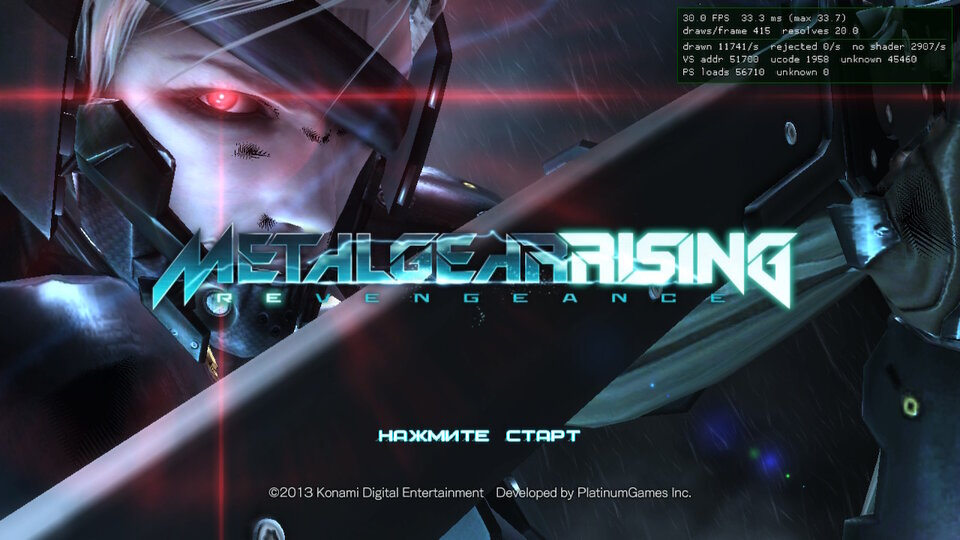
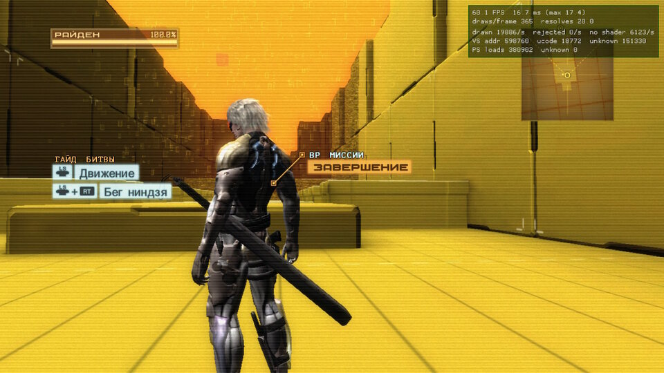
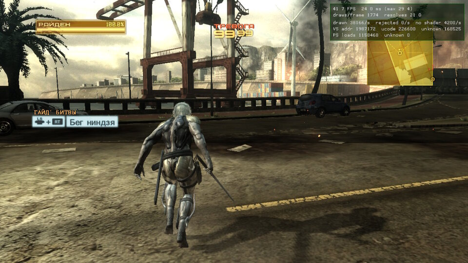
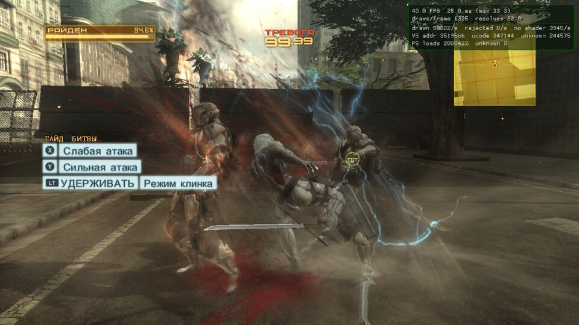

<div align="center">

# mgrr-nx

**Metal Gear Rising: Revengeance для Nintendo Switch**

Неофициальный нативный порт **Metal Gear Rising: Revengeance** (Xbox 360, 2013) на Nintendo Switch,
сделанный статической рекомпиляцией, без эмулятора.

[](#)
[](#состояние)
[](#)
[](LICENSE)

[English](README.md) | **Русский**

</div>

> [!NOTE]
> **Проект в архиве (октябрь 2026).** Он остановился на этапе M2: игра запускается и рисует стартовый экран,
> обучение и миссию R-00 на Switch собственным рендерером на deko3d (уровень команд GPU). Играбельный порт —
> **[mgr-nx-deko](https://github.com/tuancapoo/mgr-nx-deko)**. Исправления и инструменты остаются доступны под
> GPL-3.0: патчи SDK в `tools/sdk_patches/` (в том числе `0011` — память гостя не возвращалась, из-за чего игра
> зависала после первого босса), правило умножения Xenos в `tools/shaders/xenosrecomp/`, графический стенд
> (`tools/emu_test.sh`) и находки в [NOTES.md](NOTES.md).

---

## О проекте

`mgrr-nx` превращает исполняемый файл **Metal Gear Rising: Revengeance** для Xbox 360 в нативный код AArch64 для
Nintendo Switch (Horizon OS). Код игры для PowerPC заранее переводится в C++ и компилируется clang. Ядро Xbox 360,
файловую систему, звук и потоки даёт рантайм. Команды, которые игра отправляет GPU, читаются из её кольцевого
буфера и рисуются через **deko3d** — родной графический API Switch.

Во время игры эмулятора нет: собственный код игры работает как обычная программа для Switch.

**В репозитории нет кода и ресурсов игры.** Порт собирается на вашей машине из вашего собственного диска игры
для Xbox 360 (TitleID `4B4E080A`, SHA-256 `default.xex`: `907c8ebe94f085924f230d815ffa0b89c65ce60adfd00184b047276954ddf443`).
Перекомпилированный C++, переведённые шейдеры и все файлы игры остаются у вас и никуда не публикуются.

---

## Состояние

**Играть пока рано, но игра уже рисуется.** На Switch игра запускается, играет звук, реагирует на контроллер, а
собственный рендерер на deko3d рисует её целиком: стартовый экран с 3D-сценой и эффектами, меню, VR-обучение и первую
миссию R-00 с врагами, боем, частицами и HUD. Известные проблемы: чёрное мерцание на лице Райдена, подтормаживания и
частота кадров в миссиях (около 38–45 кадров/с с разгоном, см. ниже).

| Стартовый экран | VR-обучение |
| :---: | :---: |
|  |  |
| **R-00** | **Бой** |
|  |  |

<sub>Сняты на Switch (Erista), в углу — отладочный оверлей порта, октябрь 2026.</sub>

| Веха | Цель | Состояние |
| :--- | :--- | :--- |
| **M0 Фундамент** | Проект рекомпиляции, сборки для Linux и Switch из образа диска | ✅ готово |
| **M1 Загрузка** | Игра работает на PC и на Switch | ✅ готово: на PC стартовый экран (эталонная эмуляция GPU) |
| **M2 Графика** | Свой рендерер на deko3d: главное меню и начало R-00 совпадают с Xbox 360 | 🔧 в работе |
| **M3 Вертикальный срез** | Ввод, звук, ролики, сохранения: пролог R-00 проходится целиком | в планах |
| **M4 60 кадров/с** | Профилирование и оптимизация: R-00 в 60 кадров/с на Erista с разгоном | в планах |

Первая цель — вертикальный срез, пролог **R-00**, в **60 кадров/с на любом Switch с разгоном**. Если кадр не
укладывается в бюджет, снижается нагрузка (разрешение, тени, частицы, дальность), а не частота кадров.

### Что уже измерено (Switch, Erista, с отрисовкой)

| Сцена | Кадров/с | Draw за кадр | GPU за кадр |
| :--- | :--- | :--- | :--- |
| Стартовый экран и меню (игра ограничивает 30) | 30 | ~490 | 18 мс |
| VR-обучение | ~60 | 360–400 | — |
| Миссия R-00 (CPU 1785 МГц, GPU 921 МГц) | 38–45 | 800–1400 | 12–15 мс |

GPU укладывается в кадр на 60 кадров/с, дальше — процессорная часть. Подробности и все замеры — в [NOTES.md](NOTES.md).

### Что уже сделано в M2

- Библиотека шейдеров: все 1492 шейдера игры проходят путь микрокод Xenos → HLSL → SPIR-V → DKSH (двоичный формат
  шейдеров консоли). Доходят 1482, включая все шейдеры стартового экрана.
- Опознание шейдеров: пиксельных — по микрокоду (88 из 88 на стартовом экране), вершинных — через хук создания
  шейдеров в игре (находится каждый шейдер, который создаёт игра, кроме 10 непереведённых).
- Декодер кольца GPU: каждый draw игры становится запросом к рендереру deko3d, включая очистки, которые Direct3D
  делает рисованием своими шейдерами, и мультисэмпловые поверхности, через которые он их делает.
- Шейдеры связываются по номеру слота интерполянта, как на Xenos, а не по семантике: так вернулось красное
  свечение стартового экрана и другие эффекты.
- Исправления рендерера из [ds2-nx](https://github.com/VasilkovND/ds2-nx): больше форматов целей и копий, текстуры
  со знаком, частичные копии, дамп кадра.
- Тестовый стенд графики: кадры, записанные на PC, повторяются рендерером Switch (в Ryujinx и на консоли) и
  сравниваются с картинкой Xenia — по кадрам и по каждой копии внутри кадра. Стартовый экран отличается от эталона
  на 1,4 % пикселей (больше чем на 32 из 255). Цель остаётся консолью; эмулятор только отсеивает ошибки.
- Форматы вершин: упакованные нормали 10:11:11 распаковываются в шейдерах.
- Дальше: мерцание на лице Райдена, затем частота кадров.

---

## На чём построен

- **[rexglue-sdk-nx](https://github.com/nx-mod/rexglue-sdk-nx)** (подмодуль `sdk/`, BSD-3-Clause): статический
  рекомпилятор и рантайм ReXGlue (производные от Xenia), слой для Horizon OS и универсальный рендерер deko3d из
  [xbox360-nx](https://github.com/nx-mod/xbox360-nx).
- **XenosRecomp** ([hedge-dev](https://github.com/hedge-dev/XenosRecomp), MIT) с правками порта NFS Most Wanted из
  xbox360-nx: шейдеры Xbox 360 → HLSL (`tools/shaders/xenosrecomp/`).
- **DXC** (HLSL → SPIR-V), **SPIRV-Cross** и **uam** (SPIR-V → GLSL → DKSH), **deko3d** и **libnx** (devkitPro).
- **clang** для перекомпилированного кода игры на обеих платформах, **devkitA64 GCC** для рантайма и линковки на Switch.
- На PC эталонный рендерер — эмуляция GPU Xenia из состава ReXGlue; с ней сравниваем картинку.

---

## Сборка

> Это шаги для разработки: играть пока не во что.

### Что нужно

- Linux, `clang`, `cmake`, `ninja`, `python3`, Docker (образ `devkitpro/devkita64`).
- Ваш собственный образ диска Metal Gear Rising: Revengeance для Xbox 360.
- Для библиотеки шейдеров: DXC (из Vulkan SDK или пакета `directx-shader-compiler`).

### Шаги

```bash
git clone --recursive https://github.com/malinkin-s/mgrr-nx.git
cd mgrr-nx

# Распаковать диск, проверить default.xex, запустить кодоген ReXGlue и собрать Linux-версию
tools/build_from_iso.sh /путь/к/MGRR.iso

# Запуск на PC (эмуляция GPU Xenia как эталонный рендерер)
tools/run_linux.sh

# Библиотека шейдеров: build/shaders/mgrr_shaders.mgsl
DXC=/путь/к/dxc tools/shaders/build_library.sh
```

Сборка для Switch (`.nro`) настраивается в контейнере `devkitpro/devkita64` с `tools/switch_build/switch-devkitA64.cmake`.
Затем `tools/switch_build/clang_recomp.sh` компилирует код игры clang'ом и собирает `mgrr_clang.nro`. Точные
команды — в [NOTES.md](NOTES.md) (разделы M0.4, M1).

### Запуск на Switch

Atmosphère, режим title takeover (зажать **R** при запуске любой игры; порту нужно около 3,2 ГБ памяти):

```text
sdmc:/switch/mgrr/
├── mgrr_clang.nro
├── mgrr_shaders.mgsl     # ваша библиотека шейдеров
└── game/                 # файлы вашего диска: default.xex, media/...
```

Логи пишутся в `sdmc:/switch/mgrr/logs/`.

### Отладка

- `tools/nxlink.sh [IP_SWITCH]` отправляет сборку по сети (в hbmenu нажать **Y**) и принимает её лог на PC, на
  английском, вместе со скриншотами (каждые 30 с и по **L+R+Минус**): `build/nxlink_logs/<время>/`.
- `--gpu_trace_path=ФАЙЛ --gpu_trace_start=N --gpu_trace_frames=K` у PC-сборки записывает K кадров команд GPU и
  прочитанной ими памяти, начиная с кадра N (`--gpu_trace_start=0`: только по нажатию **F9**). С
  `--readback_resolve=full` сохраняется и результат Xenia для каждой копии. `python3 -I tools/gputrace.py ФАЙЛ`
  показывает сводку записи.
- `tools/emu_test.sh ФАЙЛ [ПРОХОДЫ [КАДР]]` проигрывает запись в Ryujinx сборкой для Switch и сравнивает с эталоном;
  с `КАДР` перечисляет и сохраняет каждую копию и каждый draw этого кадра (`PROBES=`, `PLAIN=` и
  `tools/resolve_ref.py` сужают расхождение до одного draw). Та же сборка проигрывает запись и на консоли:
  `tools/nxlink.sh IP -- --mgrr_replay=sdmc:/switch/mgrr/traces/ФАЙЛ`.

---

## Структура репозитория

```text
mgrr-nx/
├── game/                 # сам порт: манифест ReXGlue, хуки, чтение кольца GPU и декодер PM4
│   └── src/
├── tools/
│   ├── build_from_iso.sh # образ диска → перекомпилированный C++ → сборка для Linux
│   ├── shaders/          # конвейер библиотеки шейдеров (переводчик, упаковщик, проверка DKSH)
│   ├── switch_build/     # тулчейн Switch и сборка кода игры clang'ом
│   ├── nxlink.sh         # запуск по сети, лог и скриншоты приходят на PC
│   ├── gputrace.py       # сводка записи GPU
│   ├── emu_test.sh       # тестовый стенд графики: повтор в Ryujinx и сравнение с эталоном
│   ├── imgdiff.py        # сравнение картинок для стенда
│   ├── resolve_ref.py    # эталонные картинки каждой копии из записи
│   └── sdk_patches/      # наши исправления rexglue-sdk-nx, пока их нет в основном репозитории
├── docs/screenshots/     # скриншоты с консоли для этой страницы
├── x360_work/            # заметки по реверсу: D3D, форматы, рендеринг (только адреса и наши описания)
├── sdk/                  # rexglue-sdk-nx (подмодуль)
├── PLAN.md               # рамки, ограничения, вехи, журнал решений
└── NOTES.md              # журнал исследований и замеров
```

---

## Благодарности

- [rexglue-sdk-nx](https://github.com/nx-mod/rexglue-sdk-nx) и [xbox360-nx](https://github.com/nx-mod/xbox360-nx)
  (nx-mod): рантайм, слой для Switch и рендерер deko3d, на которых стоит порт.
- [ReXGlue](https://github.com/rexglue/rexglue-sdk) и [Xenia](https://github.com/xenia-project/xenia): рекомпилятор и исследования
  эмулятора, из которых он вырос.
- [hedge-dev](https://github.com/hedge-dev): XenosRecomp, XenonRecomp и UnleashedRecomp.
- [ds2-nx](https://github.com/VasilkovND/ds2-nx) (VasilkovND): исправления рендерера (`tools/sdk_patches/0009-…`) и
  эмуляция очисток Direct3D — по их заметкам и коду.
- [devkitPro](https://devkitpro.org): libnx, deko3d, uam и тулчейн.

Metal Gear Rising: Revengeance © Konami Digital Entertainment, разработчик PlatinumGames. Проект с ними не связан и
ими не одобрен.

## Лицензия

[GPL-3.0](LICENSE).
